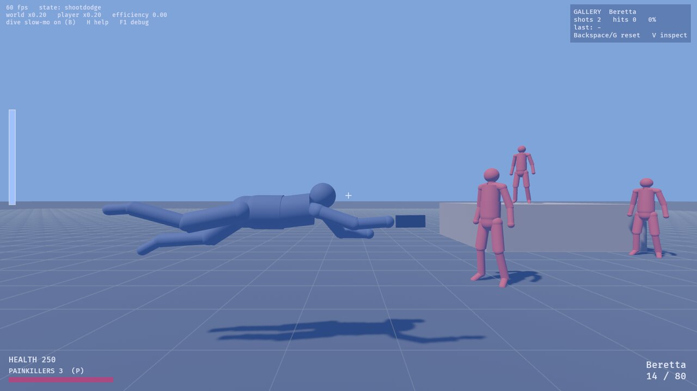
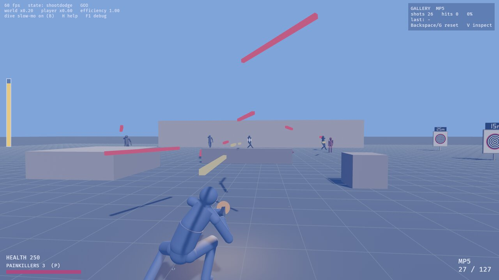

# Max Payne 2 combat, rewritten in Rust

Max Payne 2's third-person gunplay, rebuilt as a reusable Rust crate (`payne`) with a Bevy
sandbox. It covers:

- running and strafing while facing the aim, dodge rolls and crouching;
- the **shootdodge**, including diving off ledges and out of a jump, and lying on the floor
  shooting until you get up;
- **bullet time**, using the game's exact formula, with the kill "efficiency" that speeds Max up
  as the world slows down;
- real bullets with travel time, scattered the way the game scatters them;
- targets that flinch by hit zone, and ragdolls;
- **enemies** that see, hear, aim, take cover and shoot back.

The character is a capsule rig, but it moves with Max's real animations and timings, generated
from your own copy of the game.

[**▶ Demo video (31 s)**](docs/media/demo.mp4). *Played by script: a jump dive in slow
motion, a forward shootdodge, a fight with the enemy wave in bullet time, then three MP5 kills
as the bullet-time efficiency builds.*





> This is a fan project for study. It is not affiliated with or endorsed by Remedy
> Entertainment or Rockstar Games. Nothing from the game is in this repository, only code. To
> run it with real data you need your own copy of Max Payne 2; the tools here generate the data
> from it.

## What is in it

**Movement.** Run and strafe in eight directions while the body faces the aim. Crouch, jump,
and dodge-roll. Speeds and move lengths are measured from the game's animations and their
root-motion tracks, so a forward shootdodge covers the same 5.8 m it does in the game.

**Shootdodge.** The move works as it does in the game:

- the dive's own animation events slow the world to 0.2, launch Max at frame 12, and bring the
  world back to full speed at frame 30;
- you keep shooting in mid-air and from the floor;
- you get up when you move or jump.

Pressed in the air, it becomes a **jump dive**: off a jump or off a ledge. The flight pose is
held until you touch down. The game defines slots for this move but ships no animation for it,
so this is our own addition.

**Bullet time.** The per-frame update was read from `MaxPayne2.exe`, with its constants from
the game's config:

- the meter drains in 15 s and refills over 90 s;
- the world eases from 0.6 to 0.2 speed as kills raise efficiency, while Max's own clock runs
  up to 3× faster than the world;
- aiming is never slowed.

**Weapons.** All of Max's guns with the game's stats: magazine size, damage, fire rate,
spread, projectile speed, and how many pellets a shot spawns. Bullets are projectiles: you can
see them in slow motion.

**Targets and ragdolls.** Hit zones use the game's multipliers (head ×3, limbs ×0.5).
Reactions are a flinch or a stagger by zone and by the side the shot came from. Dead targets
become ragdolls, from our own position-based solver weighted by the game's ragdoll bones.

**Enemies.** Each enemy class uses the game's AI values:

- aim speed;
- the "trigger happiness" angle at which they start firing;
- inaccuracy that settles from its initial to its stable value over a few seconds;
- a 150° field of view, and hearing ranges by loudness.

Normal-difficulty multipliers are applied. Enemies take cover behind crates, peek out and
shoot, search for you when they lose you, and hold fire while an ally is in the way. Their
bullets fly at the game's 50 m/s, which is why you can dodge them in bullet time. They move
with their own style animations (Mafiosi, semi-cleaners and black ops differ). Painkillers and
health regeneration follow the game's difficulty file.

**The sandbox.** The `range` example has a shooting gallery (scored boards and an accuracy
panel), paper targets, and a combat mode with a wave of armed enemies. It can also play itself
from a script and take screenshots, which is how the demo was made.

## How faithful it is

**Read from the game's files or code:**

- the `.ras` archive format;
- the bullet-time update;
- all 481 of Max's animations, with their root motion and frame events;
- weapons and projectiles;
- Max's capsule, health and shootdodge frames;
- hit-zone multipliers;
- enemy classes, skins and style animation sets;
- the difficulty multipliers;
- gravity (20 m/s², from the level settings).

**Measured from the animations:** run, strafe and walk speeds, move lengths and gun heights.

**Still estimated:** anything marked `ESTIMATE` in the code, with a note on where the real value
probably lives. This includes:

- acceleration and turn rates;
- how enemies choose cover (the game scripts this per level; ours is our own design);
- the ragdoll, which is our own solver, not Havok.

**Not included:** sound, real meshes and textures, the game's levels, and enemies' grenades
and shootdodges.

## Controls

| Action | Keyboard / mouse |
|---|---|
| Move | WASD |
| Aim | mouse |
| Fire | left mouse |
| Bullet time | right mouse |
| Shootdodge | Shift (dives the way you're moving) |
| Jump / crouch | Space / C or Ctrl |
| Reload | R |
| Weapons | 1–7, mouse wheel |
| Painkiller | P |

Sandbox keys:

| Key | What it does |
|---|---|
| B | turn shootdodge slow motion on or off |
| F2 | combat mode: swap the targets for the enemy wave (T brings the targets back) |
| Backspace / G | reset |
| V | inspect the last board hit |
| H | all key bindings |
| F1 | debug overlay |

## Setup

You need [Rust](https://rustup.rs) and Max Payne 2 for PC (the 2003 release). The tools are
plain Rust: no Wine, Python or Windows tools, so it works on Windows, Linux and macOS.

```bash
GAME="/path/to/Max Payne 2 The Fall of Max Payne"   # your install

# 1. Unpack the game's .ras archives (about 800 MB, into mp2-files/, ignored by git)
cargo run --release -p payne-extract -- unpack "$GAME" mp2-files

# 2. Generate the data the crate loads at runtime (into assets/generated/, ignored by git)
cargo run --release -p payne-extract -- generate mp2-files assets/generated/payne.data
cargo run --release -p payne-extract -- bake     mp2-files assets/generated/anims.bin
cargo run --release -p payne-extract -- measure  assets/generated/payne.data assets/generated/anims.bin

# 3. Play
cargo run --release --example range --features bevy
cargo run --release --example range --features bevy -- --combat   # start with the enemy wave
```

Run step 2 in that order (`generate` drops the blocks that `measure` adds), and run it again
after changing anything in `tools/`.

Without step 2 everything still builds and runs, but on built-in estimates and a procedural pose
instead of the real animations.

## Using the crate

The core has no dependencies and no engine types. Bevy is only behind `feature = "bevy"`.

```rust
use payne::{Sim, GameData, Input, TestWorld, Vec3};

let data = GameData::load("assets/generated/payne.data")?;   // defaults if missing
let mut sim = Sim::with_data(Vec3::ZERO, 0.0, data);
let world = TestWorld::range();       // or your own impl of payne::World
loop {
    let input = Input { move_axis: [0.0, 1.0], shootdodge: true, ..Default::default() };
    sim.step(&world, &input);         // one 60 Hz tick
    for event in sim.drain_events() { /* sounds, effects */ }
    let anim = sim.anim();            // which clips to play, aim angles
}
```

A game connects through the `World` trait, which covers raycasts, the ground probe, capsule
push-out and cover points. It reads back:

- `sim.player`;
- `sim.targets`, which includes enemies;
- `sim.corpses`;
- `sim.projectiles`;
- the time scales.

`payne::clips` loads and samples the baked animations for any renderer. `cargo test` runs the
scripted behaviour tests: every move has an input script with an expected end state.

## Layout

| Path | What it is |
|---|---|
| `src/sim.rs`, `src/player.rs` | the simulation and the player state machine |
| `src/enemy.rs` | enemy perception, aiming, cover and tactics |
| `src/bullet_time.rs` | meter, fade, efficiency and the game-speed channel |
| `src/moves.rs` | move timelines and their frame events |
| `src/weapon.rs`, `src/projectile.rs`, `src/target.rs`, `src/ragdoll.rs` | guns, bullets, targets, ragdolls |
| `src/data.rs`, `src/tuning.rs` | runtime data loader and every tuning value |
| `src/clips.rs` | baked animation loader and sampler |
| `src/plugin.rs`, `src/plugin/` | Bevy plugin (`feature = "bevy"`) |
| `examples/range.rs` | the sandbox |
| `scripts/` | input scripts for the sandbox (`--script scripts/X.txt --shots DIR`) |
| `tools/extract/` | `payne-extract`: archive reader, KF2/SKD readers, database parser, baker, measurer |
| `docs/formats/`, `docs/behaviour/` | file format and game behaviour notes, in our own words |
| `tests/` | scripted behaviour tests |

## A note on the data

Everything the tools generate (`mp2-files/` and `assets/generated/`) is your copy of the game's
data and stays out of git. Please keep it out of forks too: share the code and let each person
generate the data from their own copy.

## Licence

MIT, for this project's code only. It grants nothing over Max Payne 2 or files generated from
it, which remain Remedy's and Rockstar's. The format notes credit the specifications in
[max_payne_ldb_importer](https://github.com/m0nstr0/max_payne_ldb_importer). That project is
GPL-3, so it was used as a reference only; none of its code is here.
